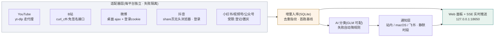

# 博主雷达 · 多平台创作者监控 web 服务

独立 web 服务：7 平台博主统一管理、新内容实时通知（带直达链接）、AI 自动分类、平台健康面板、扫码登录与「我的关注」一键导入。

> 📄 **[docs/项目文档.md](docs/项目文档.md) 是唯一正本**：功能现状、平台通道实测结论、API、配置、已知问题、变更记录（v0.1→v1.4）都在那里，与代码同步维护。面板各版本截图见 `docs/面板截图-*.png`。

## 功能

- **左侧导航七视图面板**：平台健康、内容流、监控列表、我的关注、通知中心、扫描日志、身份与登录
- **内容流 SSE 实时推送**：新内容自动浮出新卡片，不用刷新页面
- **添加向导**：粘贴任意主页链接自动识别平台与身份（支持短链展开），或从「我的关注」勾选批量加监控
- **扫码登录**（抖音 / 微博 / 小红书 / YouTube），登录态存本地 `data/identity/`
- **AI 分类**（GLM，标签可配，失败自动降规则）
- **通知**：站内 / macOS / 飞书机器人 / 飞书自建应用，支持静默时段
- **礼貌采集**：默认 600 秒一轮 + 相邻请求间隔；每博主失败隔离，一家抓不到不连累别家

## 平台通道（2026-10-16 实测）

| 平台 | 模式 | 通道 |
|---|---|---|
| YouTube | 全自动 | yt-dlp flat-playlist 枚举频道最新视频（走代理）；登录后可导入订阅列表 |
| B站 | 全自动 | curl_cffi 浏览器指纹打免签名空间接口，单次拿齐 BV号/标题/真实发布时间；低频单博主 |
| 微博 | 全自动（需成熟 cookie） | weibo.com 桌面 ajax + 登录 cookie；新扫码会话会被软风控（"前方有点拥堵"），需养熟或粘成熟 cookie 到 `config.yaml` |
| 抖音 | 全自动（需登录） | 扫码登录后：无头浏览器渲染 share 页拦截页内 XHR 取视频流；关注列表走 a_bogus 本地签名接口导入 |
| 公众号 | 半自动 | 无免登录公开出口，面板手动登记内容入册 |
| 小红书 / 视频号 | 受限置灰 | 无公开网页端出口（视频号无网页版），面板如实置灰 |

## 运行

```bash
pip install pyyaml requests curl_cffi yt-dlp playwright

python login_qr.py douyin   # 按需选 douyin/weibo/xhs/youtube，扫码后登录态存 data/identity/
python app.py               # 打开 http://127.0.0.1:18650
```

- YouTube 通道需要代理（`config.yaml` 的 `proxy.http`，默认 `127.0.0.1:7890`）；国内平台一律直连
- AI 分类 key 从环境变量 `ANTHROPIC_AUTH_TOKEN` 读取，不落盘；没有 key 自动降级规则分类
- 端口、扫描间隔、通知渠道都在 `config.yaml`，改完重启生效

## 架构



## 设计原则

- **零框架**：Python 标准库 `http.server` + SQLite 单文件数据库，前端原生 JS，零构建
- **真实数据铁律**：禁演示数据；抓不到的平台如实标红/置灰并写明原因，不拿假数据顶
- **独立自包含**：不依赖外部项目；数据只落 `data/`，删掉该目录即完全卸载
