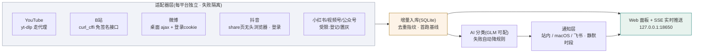

# 博主雷达 · 项目文档

> **本文档与代码同步维护**:功能新增/升级/删除,改代码的同时必须更新本文档对应章节与变更记录。
> 当前版本:v1.5.5(2026-10-18)· 服务地址:http://127.0.0.1:18650 · **全站零演示数据**(站长拍板)

## 1. 定位与红线

- 主播监控课的**参考成品包 v0**:演示课程终点产物——7 平台博主统一管理、新内容通知(带直达链接)、AI 自动分类、平台健康面板、统一添加向导。
- 独立项目:不 import 本仓库/big_v_monitor 任何模块;仅按 big_v `bilibili_monitor.py` 实测结论重写端点与请求头(抄思路不抄代码)。不碰生产登录态,不加 launchd/cron,不影响本机任何现有服务。
- 学员环境口径:Mac + WorkBuddy + 梯子,与本机零依赖。
- 范围拍板:只做「通知(带地址)+ 分类」,关键词过滤/分组/统计/下载/AI 摘要属扩展路线(课程收官节)。

## 2. 系统架构



代码结构:

```
demo/
├── app.py                 # web 服务+API 路由(标准库 http.server,端口 18650)
├── config.yaml            # 单一配置源
├── core/
│   ├── model.py           # 平台注册表(mode 分级)+ 适配器基类 + 统一内容模型
│   ├── db.py              # SQLite(creators/items/notifications/scan_logs/meta)
│   ├── http.py            # curl_cffi 浏览器指纹会话 + yt-dlp 子进程(直连/代理收拢)
│   ├── classify.py        # AI 分类+规则兜底,记录 classifier 字段
│   ├── notify.py          # 四通道通知+静默时段
│   ├── scanner.py         # 后台扫描线程(600s/轮,失败隔离,基线逻辑)
│   ├── wizard.py          # 统一添加向导(任意输入→平台识别→唯一标识解析)
│   └── seeds.py           # 首次启动种子(演示博主+演示内容)
├── web/index.html         # 前端面板(单文件)
├── docs/项目文档.md        # 本文档
└── data/                  # monitor.db(删掉=完全卸载)
```

## 3. 功能现状(随迭代更新)

| 功能 | 状态 | 说明 |
|---|---|---|
| **身份与登录(扫码)** | ✅ v1.5 | 抖音/微博/小红书:弹真浏览器窗口扫码;YouTube:弹窗走 Google 登录;**B站(v1.5 新增):纯 HTTP 二维码直接显示在面板里**(不弹浏览器,qrcode 库渲染,passport generate/poll 协议) |
| **我的关注导入** | ✅ v1.5 | **五平台接入**:抖音(a_bogus 签名接口,10-18 复验 29 位)/B站(登录 cookie+relation/followings,curl_cffi)/微博(ajax,扫码会话被软风控→config 成熟 cookie 回退)/小红书(无头浏览器开关注弹窗拦 followeduser 接口,通道就绪待重扫实测)/YouTube(登录后 feed/channels 抓全);搜索筛选→勾选批量加入并自动扫描,已监控自动标灰防重 |
| **筛选体系(三联动)** | ✅ v0.4 | 平台/博主/分类联动+只看新内容+清除筛选+计数;平台 chip/分类条/KPI 皆可点选 |
| 内容流分页 | ✅ v0.4 | 后端 limit/offset+总数;「加载更多」;SSE 新卡顶部滑入并同步计数 |
| **内容卡信息全量** | ✅ v0.5 | 完整标题(不截断)+摘要(两行)+**真实发布时间**(拿不到则明确标「入库」时间,不冒充)+博主+平台+分类+直达链接 |
| 时间人性化 | ✅ v0.4 | 今天 13:28 / 昨天 21:40 / 10-12 09:00 |
| **SSE 实时推送** | ✅ v0.3 | 新内容自动滑入+toast,页面零刷新;断线自动重连+轮询兜底 |
| 平台健康条(7 平台) | ✅ | 正常/受阻/半自动+受阻原因悬停展示(诚实口径) |
| **扫描动态时间线** | ✅ v0.3 | 每轮每平台结果流(✓/✗+原因+耗时+手动标记) |
| KPI 四卡 | ✅ | 博主数(含停用)/内容总数/今日新入库(可点击筛选)/AI 分类占比 |
| 统一添加向导 | ✅ | 主页链接/@handle/平台ID/「公众号:名字」/分享短链(v.douyin.com、b23.tv);识别→确认→自动扫描 |
| 博主管理 | ✅ | 按平台分组;启停开关/内容数/最近更新时间/删除;半自动平台行内「＋登记」 |
| 立即扫描(手动触发) | ✅ | 共用锁防并发;手动轮带「手动·」标记 |
| AI 分类(GLM-5.2) | ✅ 实测 | key 读环境变量不落盘;失败降规则;classifier 留痕 |
| 通知中心(站内) | ✅ | 博主+平台+标题+分类+链接;静默时段标暂缓;一键清空 |
| macOS 系统通知 | ⚙️ 配置关闭 | config.yaml 置 true 即用 |
| 飞书自定义 bot | ⚙️ 配置关闭 | 填 webhook 后启用 |
| 飞书自建应用智能体 | 🔜 占位 | 课程节3 实现 |
| 半自动平台手动登记 | ✅ | 登记即分类+通知+SSE 推送 |
| **抖音全自动通道** | ✅ | 免登录:匿名 ttwid+share 页浏览器渲染;v0.5 起优先用扫码登录态(更稳) |
| 首跑基线 | ✅ | 首次抓取只入库不通知(SSE 照样推卡片) |

## 4. 平台通道实测结论(2026-10-16,本机环境)

| 平台 | 结论 |
|---|---|
| YouTube | ✅ yt-dlp flat-playlist /videos 枚举稳定(走 Clash 7890);RSS feeds 端点本机出口 404/500,**已弃用**;flat 拿不到发布时间,published_at 用入库时间兜底 |
| B站 | ✅ **big_v 同款主通道(v0.7 对齐站长要求「看看 bigv 里以前怎么抓的」)**:curl_cffi chrome 指纹直打免签名 `x/space/arc/search`——单发自带 bvid/标题/真实发布时间/作者/播放数(实测 946974 影视飓风一发全中 5 条);兜底 yt-dlp 需带 `--impersonate Chrome-133 --referer` + view 接口补元数据。**限额真相**:该接口对突发多号访问敏感,低频单博主稳定——big_v 生产里 B站本来就只盯一个博主(其 CREATORS 字典仅 1 项);突发探测把配额烧红后冷却自愈,600s 轮询不轰炸。**关注导入(v1.5)**:`x/relation/followings` 匿名 -101(2026-10-18 实测必须登录)→ 走面板内嵌二维码纯 HTTP 登录(passport finger/spi 暖场→generate→poll,86090/86101 契约实测),SESSDATA+DedeUserID 落 data/identity/bilibili.json |
| 微博 | ⚠️ **wu2198 同款通道**:weibo.com 桌面 ajax `/ajax/statuses/mymblog`(端点/头/失效判定抄自 wu2198 client.py),需 cookie——config.yaml `weibo.cookie` 粘浏览器 Cookie 即全自动;匿名访客(转正 SUB)→403,m 站 getIndex→432,RSSHub 公共镜像全挂,均弃用 |
| 抖音 | ⚠️ **登录为准(2026-10-16 站长拍板「肯定需要登录,不然抓不到最新」)**:未扫码=受阻并明确提示「需要扫码登录」。通道=登录 cookie + 无头浏览器渲染 share 页 + 拦截页内同源 XHR;关注列表走 a_bogus 本地签名接口。纯 requests 打 www 签名接口会被 Argus 403(Uifid),签名逆向不做 |
| 公众号/小红书/视频号 | 无免登录公开出口 → 半自动(手动登记);**小红书关注导入例外(v1.5)**:登录态起无头浏览器开自己主页关注弹窗,拦页内 followeduser 接口(浏览器自带设备盾签名)——10-18 登录态已过期(guest),通道代码就绪待重扫实测 |
| 抖音 sec_uid 获取 | 网页搜索页是 JS 空壳抠不到;用公开分享页 URL(向导支持 douyin.com/user/ 与 m.douyin.com/share/user/ 链接);名字解析走 share 页 `_ROUTER_DATA`.nickname |
| 微博关注(10-18 复测) | ⚠️ 扫码新会话调数据接口持续软风控:`myinfo/friendships` 返回 `{"ok":0,"message":"你访问的地址不存在"}`(补 `X-Requested-With` 后接口认账但仍拒),**养两天不解**;成熟浏览器 cookie(config.yaml weibo.cookie)不受影响——following 已接 config 回退,粘上即用 |

## 5. 数据模型(SQLite,data/monitor.db)

- `creators`:博主登记。UNIQUE(platform, platform_uid);mode=auto/semi/advanced;demo=1 锁删。
- `items`:内容。UNIQUE(platform, platform_uid, item_id) 即去重指纹;is_baseline 首跑基线;simulated 演示标记;tag/classifier 分类留痕。
- `notifications`:站内通知记录,deferred=静默时段暂缓外发。
- `scan_logs`:每平台每轮扫描结果(成功/失败+原因),健康面板数据源。
- `meta`:基线标记(baseline:平台:uid)与种子标记。

## 6. 配置说明(config.yaml)

| 键 | 默认 | 说明 |
|---|---|---|
| server.port | 18650 | 已核对不与本机现有服务冲突 |
| scan.interval_seconds | 600 | 演示档轮询间隔 |
| scan.fetch_limit / request_gap_seconds | 5 / 3 | 每博主每轮条数 / 相邻请求间隔(礼貌采集) |
| proxy.http | 127.0.0.1:7890 | 仅 YouTube 通道使用,国内平台一律直连 |
| weibo.cookie | 空 | 浏览器登录微博后复制整串 Cookie 粘入 → 微博通道全自动(wu2198 同款;留空则面板标红给指引) |
| classify.* | auto + GLM-5.2 | mode=auto/ai/rules;key_env 指定环境变量名 |
| notify.silent_hours | 23:00-07:00 | 只记录不外发 |
| notify.channels.* | 仅 inapp 开 | macos/feishu_bot/feishu_app 三外部通道 |

## 7. API 清单

| 方法 路径 | 用途 |
|---|---|
| GET / | 面板页面 |
| GET /api/status | 健康+KPI+分类分布(前端 30s 自刷) |
| GET /api/items?platform=&creator_id=&tag=&new_only=&limit=&offset= | 内容流(分页+筛选,返回 total) |
| GET /api/creators / DELETE /api/creators/{id} | 博主管理 |
| POST /api/creators/{id}/toggle | 博主启停(停用=扫描跳过) |
| POST /api/wizard/parse | 向导识别(只解析不入库) |
| POST /api/creators | 向导确认入册 |
| POST /api/scan | 手动触发扫描 |
| POST /api/items/manual | 半自动登记内容(登记即分类+通知) |
| POST /api/classify/refresh | 补分类历史遗留未分类条目 |
| POST /api/notify/test | 通道自检 |
| POST /api/identity/login | 触发扫码登录(弹浏览器窗口,交互式) |
| GET /api/identity/status | 三平台登录态/扫码进行中状态 |
| POST /api/identity/bilibili/qr | **v1.5** 签发 B站登录二维码(纯 HTTP,返回 qr_png base64+qrcode_key) |
| POST /api/identity/bilibili/poll | **v1.5** 轮询扫码状态(86101 等待/86090 已扫未确认/0 成功落 cookie) |
| POST /api/following/refresh | 拉取我的关注(**抖音/B站/微博/小红书/YouTube**,需先扫码;失败原因如实返回) |
| GET /api/following?platform=&q= | 关注列表搜索(带「已监控」标记) |
| POST /api/creators/bulk | 批量加入监控并自动扫描 |
| GET /api/notifications / DELETE /api/notifications | 通知中心 / 一键清空 |
| GET /api/scanlogs | 扫描动态时间线(最近 12 条) |
| GET /api/stream | **SSE 实时流**:hello/new_items/adapter_done/scan_started/scan_round_done 事件;新内容事件带全量内容字段 |

## 8. UI 设计规范(参照 ophub)

设计语言取自 big_v_monitor `modules/opinion_hub/web/index.html`:

- 色板:bg `#f3f5f9` / 卡片白 / 边框 `#e4e8f0` / 文字 `#1c2430` / 次级 `#5a6675` / 弱 `#8a94a3`
- 强调:金铜 `#a06e08`(卡片标题竖条、分布条、演示徽章)、红 `#c93131`、绿 `#178a50`、蓝 `#1a6ee0`、青 `#0f766e`(主按钮)、紫 `#7a3ecc`(进阶标识)
- 卡片:白底 14px 圆角 + shadow-sm;标题左侧金铜渐变竖条;软色徽章(浅底深字)
- 顶栏:sticky + 白色 90% + backdrop-blur
- 平台品牌色保留(B站粉/微博橙/公众号绿…),仅用于平台标识点与内容卡左缘线

## 9. 运维

- 启动:`cd demo && /Users/NikoBelic/anaconda3/envs/stock311/bin/python app.py`(前台);后台 `nohup … > data_app.log 2>&1 &`
- 依赖:全部来自 stock311 现有环境(curl_cffi/requests/pyyaml/yt-dlp),零新增安装
- 数据:`demo/data/monitor.db`;卸载=停进程+删 data/
- YouTube 通道依赖梯子开启(Clash 7890);B站/微博直连

## 10. 已知问题

1. 微博需 cookie:粘到 config.yaml `weibo.cookie` 即全自动(浏览器登录微博→F12 复制 Cookie 整串);**扫码会话数据接口持续软风控,养两天不解(10-18 复测)**,成熟 cookie 是唯一稳路。
2. B站 yt-dlp 枚举对高频访问敏感:临时 412 属正常,600s 轮询下自愈;勿手动连点「立即扫描」轰炸。
3. YouTube flat 模式无发布时间:排序用入库时间兜底;课程版可加 RSS 优先/flat 兜底的双路。
4. 抖音 share 页偶发不发视频 XHR(约 1/5 概率):适配器带滚动催发+等待,仍空则本轮记失败下轮重试;风控波动是常态。
5. 抖音 aweme 的 create_time 字段偶尔缺失:published_at 置空由入库时间兜底,顺序仍为最新在前。
6. 飞书自建应用通道为占位,未实现(课程节3 内容)。
7. **小红书扫码登录态易过期**(10-18 复测 guest:true,间隔两天):过期后关注拉取如实报错引导重扫;关注弹窗拦截通道端到端待重扫后实测(选择器/接口形状按当期 DOM 写,页面改版需跟进)。
8. **B站关注导入端到端待真人扫码**:二维码签发/轮询契约已实测(86101 等待),登录落 cookie → relation/followings 翻页链路需扫码后验证。

## 10.5 站长验收反馈工单(2026-10-16 14:30,五条,最高优先级)

> 站长看了 v0.4 面板后的原话要点与执行口径。**与「扫码登录/关注列表」并行的两条未认领项必须本轮一起收口,完成前项目不算交付。**

1. **禁止演示数据,必须真实数据**:种子里的 6 个 demo=1 博主(深海财经观察/星尘科技早报/阿蓝的旅行手账/丸子探店记/夜航书屋/城南小食光)与【演示】模拟内容全部下线——「模拟一条新内容」按钮、/api/demo/simulate、SIMULATE_TEMPLATES、seeds 演示种子整体移除;半自动平台要么留空态引导(「扫码登录后从关注列表添加」/「手动登记」),要么配真实可核验的博主。演示角标/演统计(KPI「含演」)一并清除。
2. **小红书/视频号/抖音「受阻」原因要如实回给站长**(已答复):抖音实际每轮成功(免登录浏览器渲染,日志 ok);真正受阻的是微博(缺 cookie,扫码后解决);小红书=web 接口有设备盾签名(x-s),免登录无公开出口,登录态已建但列表接口暂不拉(进阶节);视频号=完全封闭在微信客户端内,无网页版无公开接口,扫码登录不存在,半自动是诚实天花板——面板文案要把这四句说清楚,别让人误读「受阻」。
3. **扫码登录**:login_qr.py+identity 已建(app 内 /api/identity/*),面板必须有显眼入口(「身份与登录」卡:三平台扫码按钮+状态灯+重新扫码),别让站长找不到。
4. **关注列表导入**:following.py 已建(抖音 a_bogus 签名接口/微博 ajax;小红书设备盾暂缓)——面板要接「我的关注」抽屉:拉取→搜索筛选→勾选批量加入监控。
5. **前端 UI 重做(站长原话「做的很差,排版不合理」)**:给内容流让出充分空间——压缩侧栏/KPI/健康条占高,内容卡信息补全:标题(完整不截断)+摘要(有则显示)+发布时间(真实 published_at,别拿入库时间冒充)+博主+平台+分类+直达链接;列表密度与层级按 ophub 内容流标准重排。

**→ v0.5 处置结果(2026-10-16 15:00,五条全收口)**:①演示数据删净(种子只留 8 位真实博主、模拟按钮/API/演角标/「含演」统计全移除,实测 creators=8/items=20/simulated=0);②受阻原因已写进平台条悬停提示(model.py note 字段)+工单答复;③「身份与登录」卡置于右栏首位(三平台扫码+状态灯+轮询自动变绿);④「从我的关注导入」弹窗(拉取→搜索→勾选→批量加入并自动扫描)已接;⑤布局改为内容流主导(1fr/340px,wrap 1560px),内容卡=完整标题+两行摘要+真实发布时间(拿不到的平台明确标「入库」不冒充,2026-10-16 工单第 5 条修正)+直达链接。待人工验收项:扫码登录与关注拉取需真人扫码实测(代码路径已编译+错误分支已验证)。

## 11. 变更记录(倒序)

- **v1.5.5(2026-10-18 深夜,B站回浏览器窗+微博全链路打通)**:站长两条反馈收口。①**B站放弃面板内嵌二维码**(站长实测扫码不行)——整个纯 HTTP 二维码链路移除(identity 的 qr_start/poll、两条 API 路由、前端弹层),回归与其他平台一致的**弹浏览器窗口扫码**(login_qr bilibili:SESSDATA+DedeUserID 双登录专属 cookie 判定,游客实测两者皆无,不误判)。②**微博关注拉取全链路打通**(实弹:站长 23:48 用 v1.5.4 修好的弹窗真扫码,weibo.json 172KB 真会话):通道改**真浏览器内同源 fetch**(python 直打 myinfo/friendships 连 Chrome 成熟 cookie 都过不了 JS 挑战/404,实测);修响应解析坑——**users/hasmore 在顶层不在 data 下**(与抖音关注接口同款);config.yaml 成熟 cookie 兜底保留(注入浏览器上下文)。③微博登录同步改**主 Chrome 导入优先**(chrome_import 通用化:任意域提取+weibo_wait_and_import+无头真浏览器验 $CONFIG.uid 坐实——站长 Chrome 当前是未登录游客态,导入需先在 Chrome 里登录微博);扫码弹窗路径保留且已修好。④**小红书寿命定性**:23:42 真扫码、~20 分钟后服务端判访客——扫码 web_session 寿命分钟级,通道代码在但会话保不住,如实标注(现实解=进阶或 Chrome 导入,待观察)。⑤站长扫码实录验证 v1.5.4 判定修复有效(窗口等到真登录才关)。面板 chips:抖音 29/微博 2/小红书已失效/YouTube 5/B站未登录。
- **v1.5.4(2026-10-18,扫码窗口误关根修)**:站长实测「微博/小红书弹窗还没登录窗口就消失、状态变已登录」——根因:登录判定只看 cookie 名出现,**微博给游客也发 SUBP**(无头实测:weibo.com 游客一打开就有 SUB/SUBP/WBPSESS 全套,老判定秒判已登录→关窗+存游客会话);小红书登录流程中间态也可能短暂出现 web_session。修法:`_looks_logged_in` 双条件=目标 cookie(值≥8位)+**页面登录指纹**(weibo=`$CONFIG['uid']` 非空,仅登录后有值;xhs=侧栏出现 `a[href*="/user/profile/"]` 头像链接;douyin sessionid 游客本就没有,保持),且**连续两轮(约4秒)确认**才收窗口,躲开扫码后-手机确认前的中间态;tip 文案写明「窗口只认真登录」。负向实测:游客页面下 weibo 老判定=误判(True)/新判定=False,xhs 双判定均 False——游客不再被误判;真扫码路径待站长下次扫码验证。副作用说明:此前 v0.5-1.5.3 存下的微博/小红书"登录态"可能本就是游客会话(小红书两天即 guest 的真实原因),重扫后才是干净会话。
- **v1.5.3(2026-10-18,YouTube 登录改走主 Chrome 导入)**:站长实测「弹窗浏览器无法登录 Google」(Google 登录页拦自动化浏览器,报「此浏览器或应用可能不安全」)并点名「为什么不用我的主 Chrome」——新增 `core/chrome_import.py`:**直接读主 Chrome 里现成的 youtube.com cookie**(macOS Chrome cookie 用 Keychain「Chrome Safe Storage」密钥 PBKDF2+AES-128-CBC 解密 v10 前缀;拷库文件副本避开运行锁;遍历 Default+全部 Profile;全程本机,只落 data/identity/youtube.json)。login_qr.py 的 youtube 分支改为「打开主 Chrome 到 youtube.com → 轮询读 cookie 直到出现 SAPISID」,不再弹 Playwright 窗口;身份行 tip/通道实况文案同步。**实测一次过**:站长 Chrome 里本就登录着,20 个 cookie(SAPISID/__Secure-1PSID 全套)直接读出,订阅导入拉回 **5 个频道**;面板验证 YouTube 行绿灯、弹窗拉取成功、chips「YouTube · 已拉 5 位」、零 JS 错误。前置条件:运行进程要有 Chrome 目录磁盘访问权限(首次读 Keychain 可能要点一次允许)。
- **v1.5.2(2026-10-18,拉取弹窗+状态灯如实)**:站长看截图点名两条——①「拉取这个直接做弹窗呗」:拉取关注从底部 toast(一闪而过、失败信息留不住)改为**统一弹窗**(`#pullmodal`):选平台(带真实状态标签:已拉 N 位/已失效/未登录)→ 开始拉取 → 结果留在弹窗里,失败给「去身份与登录处理/重试」、成功给「去勾选加入监控」;我的关注视图按钮与身份视图「拉取我的关注」都走这个弹窗,拉取中禁用防双击。②「登录失效的为什么状态还是绿色」:身份行状态从「文件存在=绿」改为**真实可用性**——新增 stale 态(红点+原因),由 following.refresh 按实际结果回写(成功→ok,被服务端拒绝[失效/访客/软风控]且确有登录文件→stale;从没登录过不写,保持未登录);当天实测真相已落:xhs=已失效(访客)/weibo=已失效(软风控)/douyin=ok(29 位);chips 与弹窗标签同步显示「已失效」;B站二维码过期(86038)回写 timeout 不再永久挂「等待扫码」。实测:身份行红绿如实、弹窗失败信息留存+下一步入口、抖音成功路径、零 JS 错误。
- **v1.5.1(2026-10-18,关注列表手动刷新)**:站长点名「关注列表应该支持点击按钮手动刷新」——「我的关注」视图顶部按钮从「重读本地库」改为**真拉平台**(调 /api/following/refresh 拉当前选中平台,拉取中禁用防双击,完成后计数与 chips 同步;未登录/受阻平台如实 toast 原因);从「身份与登录」发起的拉取保持拉完自动跳转。顺修:identity 接口补 `following_count`(chips 上的关注数之前一直显示不出来),身份视图拉取也走同一防抖。实测:按钮 拉取中…禁用→恢复、共 29 位关注、chips「抖音 · 29」、零 JS 错误。
- **v1.5(2026-10-18,五平台关注导入)**:站长问「为什么看不到我抖音/小红书/B站等各站关注列表,你抓不到么」——逐平台重探+补齐。①**B站从零接入**:关注接口 `x/relation/followings` 匿名 -101(必须登录)→ 新增**面板内嵌二维码纯 HTTP 登录**(passport finger/spi 拿 buvid3 暖场 → generate 签发 → poll 轮询,qrcode 库渲染 PNG 直显面板,不弹浏览器窗;实测 86101 等待契约 OK),登录 cookie 落 data/identity/bilibili.json,关注翻页 curl_cffi+SESSDATA(1.2s 间隔礼貌采集);②**小红书通道从「暂缓」改「就绪待实测」**:无头浏览器(登录态)开自己主页关注弹窗,拦页内 followeduser 接口(浏览器自带设备盾签名,绕开签名逆向)+滚动翻页+响应去重——10-18 实测发现扫码登录态已过期(user/me 判 guest),拉取时如实报错引导重扫,端到端待重扫后验证;③**微博软风控终定性**:扫码会话数据接口养两天仍拒(`{"ok":0,"message":"地址不存在"}`,补 X-Requested-With 后接口认账但照拒),curl_cffi 指纹无效 → following 接 config.yaml weibo.cookie 成熟 cookie 回退,报错文案如实说破;④抖音两天后复验仍稳(29 位拉取成功);⑤面板:身份行 5 平台齐(B站扫码=面板二维码弹层,可取消;已登录行补「重新扫码」)、我的关注 chips 解除小红书排除、平台通道实况卡文案对齐现状。实测:身份行=5、B站 QR 弹层真图(naturalWidth>0)可扫可关、关注 chips=5、零 JS 错误;GitHub 仓库同步。
- **v1.4(2026-10-16 晚,流程图重制)**:站长点名「有开源工具不用,得用符号画」——两份文档的 ASCII 图全部重制为 **mermaid** 流程图(教学文档=三角色工作原理图,带配色与样式;项目文档=系统架构图,适配器层/增量入库/分类/通知/面板分层);PDF 管线沉淀为可复用脚本 `work/md2pdf.py`(md→HTML→PDF,mermaid 本地离线渲染 `work/assets/mermaid.min.js`,自动等待 svg 渲染完成),实测两份文档各 1/1 张图渲染成功;教学文档 PDF 已重发飞书。
- **v1.3(2026-10-16 晚,工作原理章节)**:教学文档新增第二章「先搞懂:助手到底是怎么帮你干活的」(站长拍板「工作原理要讲清楚」)——三个角色模型(大模型=云端大脑:只看得到文字/记不住上次/会一本正经说错话;你的电脑=工地;助手工具=翻译官+手,配 ASCII 角色图)+ 博主雷达定位为第三角色(造好后自己活,断网助手歇菜服务照跑)+ 拿"加搜索框"走一遍完整来回 + 方法论六条逐条从原理推出 + 额度常识;名词解释补「大模型/云端/上下文窗口」;章节重排为七章并修正交叉引用。PDF 重出并飞书直发。
- **v1.2(2026-10-16 晚,方法论章节)**:教学文档新增第三章「通用方法论:提需求、提问、验结果」(站长拍板)——①提需求四条:默认一次一个小需求("连用三个'然后/还要'就该拆")、**宏观/微观按实际情况切换**(你知道的坑说出来,不知道的交给助手并要求先小规模验证)、好需求四件套(目标/背景/边界/验收,表格呈现)、大需求先让助手复述+一次只改一处;②提问两式:求解释(大白话+追问不要钱)+求修理(黄金模板+三个分寸:给事实不给结论/给线索/追问三连),五个翻车故事并入;③验结果:铁律(说完成≠完成,三种假完成形态)+验什么(主路径/边界/回归)+三件武器(亲手点/命令点/看日志)+验收前置。原「五条心法」精简为方法论浓缩版,章节重排(一~六)。PDF 重出并飞书直发。
- **v1.1(2026-10-16 晚,双指令版)**:教学文档按站长拍板重构——每步(0-9)提供两版指令:**A 版·白话版**(学员自然会说的话,只说需求与方向,零实现细节)与 **B 版·带路版**(预埋实战通道结论与坑位的原详细版);「怎么用」章节说明双版用法(练本事先 A 冲、卡住 B 救场;赶时间直接 B)与教学立意(经验=指令里多出的几句话);结尾点题呼应。PDF 重出并飞书直发。
- **v1.0(2026-10-16 晚,学员版重写)**:教学文档按站长两条规定全面学员化——①开头新增 18 条名词解释(接口/风控/Cookie/扫码登录/签名暗号/无头浏览器/代理/SSE 实时推送/去重指纹/演示数据等,全部大白话+生活比喻);②全文去黑话:探针→先探路再修路、失败隔离→一家出事不连累别家、falsy 陷阱→"0 被当成没有"、死锁→把自己锁屋里、站长/工单/wu2198 等内部词全清;五个真实 bug 改写成五个小故事;十步指令卡(0 骨架→9 收官)每步=目标+可复制指令+亲手验收,学员照做可复现当前成品;内部绝对路径改为学员侧相对说明。PDF 已重出并飞书直发。
- **v0.9(2026-10-16 晚)**:交付三件套之二「给 Agent 看的开发流程」落地——新增 `教学文档-用CodeAgent开发项目.md`:五条协作心法(分阶段/先探针后代码/失败隔离+诚实/可验证/文档同步)+阶段0-9可复制指令卡(每阶段含完整 prompt、验收标准、预埋实测坑位:B站限频、抖音三坑、falsy 陷阱等)+排障黄金模板(现象/期望/复现/信息/先诊断再动手)+五条红线;全部取自本项目当日真实开发路径。README 已加链接。
- **v0.8(2026-10-16 晚,站长扫码后实弹验证轮)**:①**抖音关注列表全链路打通**(实弹:拉回站长真实关注 29 位)——连修三 bug:`_douyin_get` 的 `int(status_code or -1)` falsy 陷阱(成功码 0 被当失败,从第一版起所有成功响应都被误拒);followings/has_more/max_time 在响应**顶层**不在 data 下;分页游标卡死重复计数(改游标不动即断+以表内 UNIQUE 真实数为准);另加 big_v 同款 3 次重试(新指纹+退避)。②**YouTube 登录位补上**(站长:「怎么没看到 youtube 的扫码登录」)——Google 登录走弹窗账号登录(不一定是二维码,检测 SAPISID,浏览器走 Clash 代理);登录后解锁**订阅列表导入**(feed/channels 滚动抓全,UC 号与 @handle 双 uid 兼容,youtube 适配器同步支持)。③**微博定性**:扫码成功/公开接口正常,但 mymblog/friendships 对新会话一律空响应/403「前方有点拥堵」(非 cookie 域问题、非 webdriver 检测、隐身无效)——处置=每轮自动重试等会话养熟 + config 粘日常浏览器成熟 cookie(wu2198 生产同款)。④login_qr 登录后先访平台主页再存(暖场防新会话软风控)。实测:身份行=4、导入 chips=抖音/微博/YouTube、29 位真实关注可搜可选、零 JS 错误。
- **v0.7(2026-10-16 下午,站长三点拍板)**:①**抖音登录为准**(站长:「肯定需要登录,不然抓不到最新数据」)——适配器未扫码即受阻并提示「需要扫码登录」,不再赌免登录 share 页波动;②**视频号置灰**(站长:「抓不到功能置灰」)——PLATFORMS[sph].disabled=True:chip 灰化不可点、平台下拉移除、向导拒绝并给「跨平台同名覆盖」建议、add/bulk 接口拒绝;③**B站补齐 big_v 老打法**(站长:「你看看我 bigv 里以前怎么抓的」)——主通道=curl_cffi chrome 直打免签名 `x/space/arc/search`(一发自带标题/真实发布时间/作者/播放数,实测 946974 全中),兜底 yt-dlp 补 `--impersonate Chrome-133 --referer`(此前缺这俩);种子收敛为单博主(946974,罗翔下线——该 mid 持续被风控单独照顾)。实测:置灰 chip=1/下拉 7 选项(视频号移除)/抖音未登录提示清晰/零 JS 错误;B站限频=开发探测耗配额,冷却自愈。
- **v0.6(2026-10-16 14:4x)**:站长拍板「不要总览单页,抄 ophub 左边导航栏,功能做进去」——①面板重构为**左侧导航+七视图**:.rnav 186px 固定侧栏(收起 52px 图标条,localStorage 记忆;手机<900px 抽屉+遮罩)+.rmain 让位;②总览堆叠解散:KPI+平台条→「平台健康」视图;身份/向导/监控列表/通知/扫描各自成视图;**内容流独占主区**(958px 实测,右侧仅留 250px 分类分布窄栏,≥1200px 才显示);③「我的关注」从弹窗升级为独立视图(平台chips+搜索+勾选批量加,拉取完自动跳转);④「身份与登录」视图新增**平台通道实况**卡(七平台为什么全自动/受限,如实说明);⑤通知中心导航未读角标(进视图即消);⑥视图切换 localStorage 记忆。服务已重启(旧进程缺 /api/identity 等新端点)。Playwright 实测:7 导航项/切视图/折叠 186→52/手机抽屉+遮罩/零 JS 错误;截图 docs/面板截图-v0.6-*.png。

- **v0.5(2026-10-16 下午四轮,工单收口)**:①**删净演示数据**(站长拍板「禁止演示数据」):演示种子/模拟按钮/simulate API/演角标全下线,种子只剩 8 位真实博主;②**身份与登录(扫码)**:login_qr.py 弹真浏览器扫码(抖音/微博/小红书),登录态存 data/identity/,抖音适配器优先用登录态、微博适配器优先于 config cookie;③**我的关注导入**:抖音(a_bogus 本地签名+following/list)/微博(ajax friendships)拉全量关注,弹窗搜索筛选勾选批量入监控;④**排版重做**:内容流主导(1fr/340px),内容卡信息全量(完整标题/摘要/真实发布时间,拿不到标「入库」不冒充/直达链接);⑤平台受阻原因进面板悬停;⑥小红书/视频号/公众号诚实标注原因。实测:creators=8 全真实、douyin+youtube 各 10 条真数据、0 演示、导入弹窗/身份卡/筛选交互零 JS 错误。
- **v0.4(2026-10-16 下午三轮)**:全站细节升级——①修复平台筛选下拉从不填充的 bug,并升级为**三联动筛选**(平台↔博主互锁+只看新内容+清除筛选+计数徽标);②筛选多入口:平台 chip/分类分布条/KPI 今日卡皆可点击筛选;③内容流分页(加载更多);④时间全站人性化(今天/昨天/月-日 时:分);⑤博主列表按平台分组+启停开关+每行最近更新时间;⑥通知中心一键清空;⑦扫描日志带耗时与手动标记;⑧向导支持分享短链解析(v.douyin.com/b23.tv),加入即自动触发扫描;⑨favicon。Playwright 交互实测:下拉 8 选项/chip 点击筛出 10 条抖音卡/只看新内容/清除筛选恢复 37 条,零 JS 错误。
- **v0.3(2026-10-16 下午二轮)**:①**抖音升级为全自动必修**(用户拍板「必须做」):免登录浏览器渲染路线实测定稿并落地,央视新闻/央视网真数据入库;②**微博改 wu2198 同款通道**:weibo.com 桌面 ajax + config cookie 配置位(端点/头/失效判定抄自 wu2198 client.py);③**SSE 实时推送**:新内容自动滑入新卡片+toast,页面零刷新,断线自动重连+轮询兜底;④新增「扫描动态」时间线卡;⑤修复 scanner 变量笔误(new_ids 误写 new_items)导致整轮扫描中断——失败隔离范围扩大到单博主全流程;⑥SSE 客户端断开不再刷 socketserver 噪音栈。渲染终检:7 chips/37 卡/9 扫描记录/零 JS 错/SSE 灯亮。
- **v0.2(2026-10-16 下午)**:前端整体切换为 ophub 设计语言(浅色+白卡+金铜强调+软色徽章);建立本文档并立「文档与代码同步」纪律;JS 语法校验通过。
- **v0.1(2026-10-16 中午)**:初建。核心层(model/db/http/classify/notify/scanner/wizard/seeds)+三自动适配器+四半自动占位+web 面板;修复 db.ingest 重入锁死锁(持锁调 meta_set,扫描线程冻结);首轮真实扫描 YouTube 10 条入库+GLM 分类 10 条;向导/模拟/手动登记/通知中心端到端验证通过。
